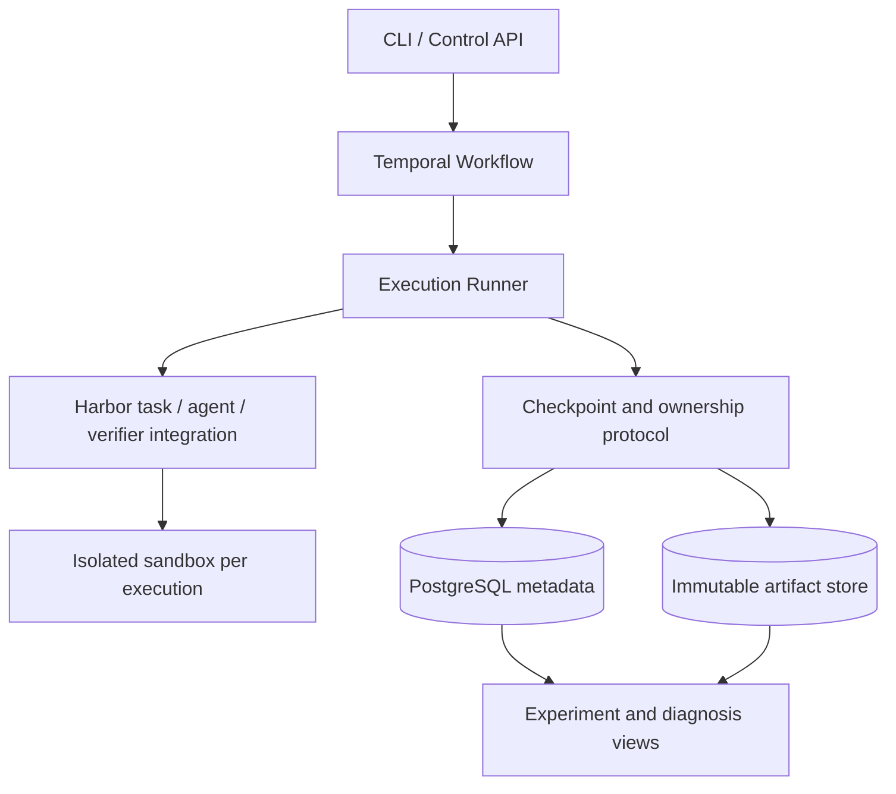

# Relay Trace Verify (RTV)

[](README.md) [](README.en.md)

*A platform for reliable agent execution and evaluation.*

A recoverable execution and branching experiment system for long-running coding agents.

**Status: F0 complete; M0 in progress.** The local relay demo, domain models, file checkpoints, and event logging now have a pinned Harbor fixture, environment preflight, and container recovery prototype. Mocked protocol tests and a real file-recovery round trip on local ARM64 Docker pass. Real agents and Temporal are not integrated yet.

RTV supports learning through reproduction, system implementation, and original exploration. Existing approaches remain learning material and comparison baselines; see the [learning and resource plan](docs/learning-plan.en.md) for sources and scope. No model-performance or distributed-reliability claims have been established.

## Quick start

Requires Python 3.11+ and uv. Run from the repository root:

```bash
uv sync --locked --dev
uv run rtv demo --output work/demo
```

The demo uses two deterministic fixtures, with no model calls or API keys. A writes a file and commits a checkpoint. B restores it into an independent directory, modifies the result, and passes it to a verifier. Outputs include `events.jsonl`, `report.json`, workspaces, and checkpoints.

The output directory must not already exist. Choose a new path, such as `work/demo-2`, for another run. The local backend uses ordinary directories and does not provide container or process isolation.

Development checks:

```bash
uv run pytest
uv run ruff check src tests
uv run ruff format --check src tests
```

See the [framework development guide](docs/framework.en.md) for modules, current guarantees, and extension points.

The Harbor prototype uses an optional dependency group and Python 3.12+. See the [M0 guide](docs/m0.en.md) for installation, preflight, and container test commands. Normal tests skip real-container execution; the guide records the separately executed real smoke test and its evidence.

## Core problem

When an agent gets stuck, a worker disconnects, or a sandbox is destroyed, how can the next execution recover a consistent workspace and session, and fairly compare different continuation strategies from the same checkpoint?

RTV focuses on three capabilities:

1. **Relay**: recover execution, hand work to another agent, or create isolated branches through consistent checkpoints.
2. **Trace**: connect tool events, workspaces, checkpoints, handoffs, and costs to identify the layer where a failure occurred.
3. **Verify**: measure system reliability and agent task performance through independent verification and paired experiments.

## Design documents

| Document | Contents |
| --- | --- |
| [Framework development guide](docs/framework.en.md) | Current code, run instructions, validation scope, and integration boundaries |
| [M0 integration guide](docs/m0.en.md) | Harbor preflight, container recovery prototype, capability matrix, and current gaps |
| [Learning and resource plan](docs/learning-plan.en.md) | Open-source references, reproduction goals, lab GPUs, and spending agreement |
| [System design](docs/design.en.md) | Object relationships, invariants, checkpoint protocol, failure handling, budgets, and adapter capabilities |
| [Experiment protocol](docs/experiments.en.md) | Paired branches, budget accounting, baselines, statistics, and result artifacts |
| [Roadmap](docs/roadmap.en.md) | Implementation order, acceptance evidence, and open decisions |
| [ADR 0001](docs/adr/0001-runtime-boundary.en.md) | Responsibility boundaries between Harbor, Temporal, and the RTV runtime |

## Proposed architecture



This diagram shows the complete target architecture; current code covers the local framework and M0 integration preparation. Real-container and real-agent tests must still establish the specific Harbor integration boundary.

## Technical boundaries

- Harbor: reuse task formats, agent and sandbox adapters, verifiers, and ATIF trajectories.
- Temporal: reuse durable orchestration, timers, and Activity retry mechanisms.
- RTV: implement checkpoint commits, execution ownership, recovery and handoff semantics, branch isolation, and budget attribution.
- Initially support reconstructible local filesystem tasks. External databases, arbitrary process memory, and external service side effects are outside the checkpoint guarantee.
- Collect objective events from the first phase. LLM judges and training-data selection are later extensions.

## First demonstration target

Agent A modifies code → commit a checkpoint → inject a worker failure → recover on another worker → fork from the checkpoint to A and B → verify independently and show complete costs.

Implementation status and experimental conclusions will be recorded separately. Unmeasured numbers will not be presented as project results.

## References

- [Ember](https://github.com/RuokeZhang/ember): a reference for engineering scope.
- [Harbor trajectory loading](https://docs.harborframework.com/jobs/loading-trajectories): loading a session or trajectory does not restore sandbox files.
- [Harbor ATIF](https://docs.harborframework.com/agents/atif): trajectory format and validation.
- [Temporal Activities](https://docs.temporal.io/activity-definition): retry and idempotency boundaries.

Research date: 2026-10-07. Pin dependency versions during implementation and verify capabilities with contract tests.
