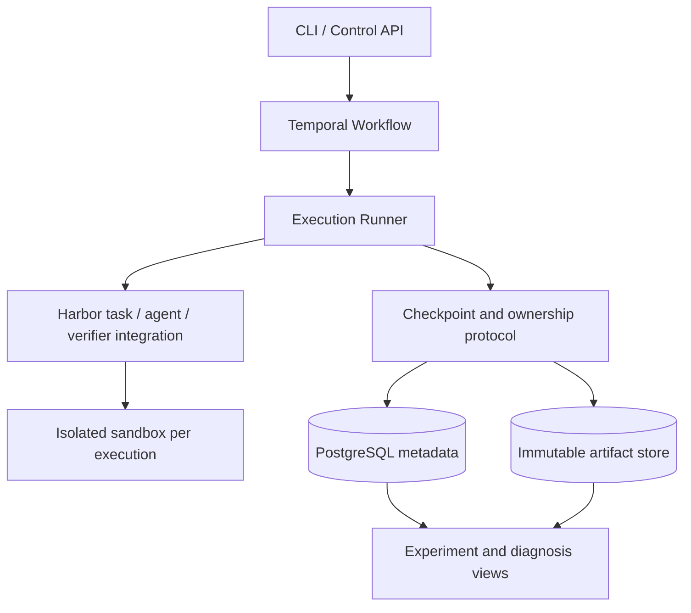

# Relay Trace Verify (RTV)

[](README.md) [](README.en.md)

*A platform for reliable agent execution and evaluation.*

A recoverable execution and branching experiment system for long-running coding agents.

**Status: F0–M3 accepted within the local trusted-development-task scope.** M3 adds idempotent handoff, four branches from one checkpoint, isolated verification, prefix attribution and a bilingual read-only viewer. It passes 48 zero-cost protocol checks and 14 real-model checks: native Codex continuation and mini-swe-agent workspace, summary and text-trajectory handoffs all complete the task. This validates functionality, not relay success-rate or cost advantages. See the [M3 guide and evidence](docs/m3.en.md).

**M4 in progress: local Kubernetes execution and a real-task experiment protocol are available.** Two control workers, two execution nodes, resource reservations, node recovery and raw reports are tested without model calls. SWE-bench Verified selection is frozen at four development and twenty evaluation tasks; paired analysis and offline verifier controls for the first development task pass. The first real-model pilot has four graded branches; formal evaluation is incomplete. See the [M4 guide](docs/m4.en.md) and [task/statistics protocol](docs/m4-benchmark.en.md).

Local checkpoints, scripted relay, a fresh baseline and fault recovery for the first real repository
pass 26 checks; see [repository integration](docs/m4-repositories.en.md). Reference-patch controls do
not establish model effectiveness.

Subsequent [Kubernetes repository acceptance](docs/m4-repository-cluster.en.md) passes 28 checks for
task delivery, four-branch observation linkage and recovery on another node after Job loss.
This covers scripted controls on one development repository only.

[Model credentials and the pilot launcher](docs/m4-model-pilot.en.md) are implemented: 17 fake-credential
checks pass across both nodes. Prior results are retained; the third run raises input to 160 KB, passes
13 real-model workflow checks and grades all four branches solved. B-workspace exhausted its eight
requests but passed independent grading; there were no input-limit stops. Three attempts total 45 API
requests and $0.11725620 under the increased $20 cumulative budget, with unknown subscription cost.
The prefix already had the core repair; unfinished-work rescue or relay advantage is not established.

RTV supports learning through reproduction, system implementation, and original exploration. Existing approaches remain learning material and comparison baselines; see the [learning and resource plan](docs/learning-plan.en.md) for sources and scope. No model-performance advantage or multi-physical-host reliability claim has been established.

## Quick start

Requires Python 3.11+ and uv. Run from the repository root:

```bash
uv sync --locked --dev
uv run rtv demo --output work/demo
```

The demo uses two deterministic fixtures, with no model calls or API keys. A writes a file and commits a checkpoint. B restores it into an independent directory, modifies the result, and passes it to a verifier. Outputs include `events.jsonl`, `report.json`, workspaces, and checkpoints.

The output directory must not already exist. Choose a new path, such as `work/demo-2`, for another run. The local backend uses ordinary directories and does not provide container or process isolation.

Development checks:

```bash
uv run pytest
uv run ruff check src tests
uv run ruff format --check src tests
```

See the [framework development guide](docs/framework.en.md) for modules, current guarantees, and extension points.

The Harbor prototype uses an optional dependency group and Python 3.12+. See the [M0 guide](docs/m0.en.md) for installation, preflight, and container test commands. Normal tests skip real-container execution; the guide records the separately executed real smoke test and its evidence.

## Core problem

When an agent gets stuck, a worker disconnects, or a sandbox is destroyed, how can the next execution recover a consistent workspace and session, and fairly compare different continuation strategies from the same checkpoint?

RTV focuses on three capabilities:

1. **Relay**: recover execution, hand work to another agent, or create isolated branches through consistent checkpoints.
2. **Trace**: connect tool events, workspaces, checkpoints, handoffs, and costs to identify the layer where a failure occurred.
3. **Verify**: measure system reliability and agent task performance through independent verification and paired experiments.

## Design documents

| Document | Contents |
| --- | --- |
| [Framework development guide](docs/framework.en.md) | Current code, run instructions, validation scope, and integration boundaries |
| [M0 integration guide](docs/m0.en.md) | Harbor preflight, container recovery prototype, capability matrix, and current gaps |
| [Codex recovery experiment](docs/codex-m0.en.md) | First real agent, native/semantic handoff, recovery boundaries and usage evidence |
| [M0 acceptance and recovery boundaries](docs/m0-boundaries.en.md) | ATIF information loss, real cancellation/rollback, image lifecycle and capabilities |
| [M1 durable execution](docs/m1.en.md) | Local services, submit/cancel, fault injection, real Codex and boundaries |
| [M2 checkpoints and recovery](docs/m2.en.md) | Conditional commits, epochs, native resume, UNKNOWN usage, reference GC and acceptance |
| [M3 handoff and branches](docs/m3.en.md) | Second agent, context policies, isolated verification, viewer and API budget |
| [M4 Kubernetes execution](docs/m4.en.md) | Local multi-worker/node faults, resource quotas, recovery and raw reports |
| [M4 real tasks and statistics](docs/m4-benchmark.en.md) | Frozen SWE-bench subset, paired protocol, offline controls, missing data and UNKNOWN costs |
| [M4 repository integration](docs/m4-repositories.en.md) | Task contracts, directory-mode snapshots, hidden-test separation and scripted recovery |
| [M4 repository Jobs and observations](docs/m4-repository-cluster.en.md) | Task delivery, resources, cross-node recovery and runtime-derived paired records |
| [M4 model credentials and pilot](docs/m4-model-pilot.en.md) | Per-run admission, Secret projection, real-model launcher and cost boundaries |
| [Learning and resource plan](docs/learning-plan.en.md) | Open-source references, reproduction goals, lab GPUs, and spending agreement |
| [System design](docs/design.en.md) | Object relationships, invariants, checkpoint protocol, failure handling, budgets, and adapter capabilities |
| [Experiment protocol](docs/experiments.en.md) | Paired branches, budget accounting, baselines, statistics, and result artifacts |
| [Roadmap](docs/roadmap.en.md) | Implementation order, acceptance evidence, and open decisions |
| [ADR 0001](docs/adr/0001-runtime-boundary.en.md) | Responsibility boundaries between Harbor, Temporal, and the RTV runtime |
| [ADR 0003](docs/adr/0003-fenced-checkpoints.en.md) | M2 ownership, checkpoint publication and collection decisions |

## Proposed architecture



This diagram shows the target architecture. M3 implements local handoff and experiment branches on M2 epochs, checkpoints and accounting, with separate mini API request entries. Artifacts remain local. Object storage, multi-host resource fencing and general strict budget admission remain unimplemented. Real two-agent functionality is validated on one fixed development task.

## Technical boundaries

- Harbor: reuse task formats, agent and sandbox adapters, verifiers, and ATIF trajectories.
- Temporal: reuse durable orchestration, timers, and Activity retry mechanisms.
- RTV: implement checkpoint commits, execution ownership, recovery and handoff semantics, branch isolation, and budget attribution.
- Initially support reconstructible local filesystem tasks. External databases, arbitrary process memory, and external service side effects are outside the checkpoint guarantee.
- Collect objective events from the first phase. LLM judges and training-data selection are later extensions.

## First demonstration target

Agent A modifies code → commit a checkpoint → inject a worker failure → recover on another worker → fork from the checkpoint to A and B → verify independently and show complete costs.

Implementation status and experimental conclusions will be recorded separately. Unmeasured numbers will not be presented as project results.

## References

- [Ember](https://github.com/RuokeZhang/ember): a reference for engineering scope.
- [Harbor trajectory loading](https://docs.harborframework.com/jobs/loading-trajectories): loading a session or trajectory does not restore sandbox files.
- [Harbor ATIF](https://docs.harborframework.com/agents/atif): trajectory format and validation.
- [Temporal Activities](https://docs.temporal.io/activity-definition): retry and idempotency boundaries.

Research date: 2026-10-07. Pin dependency versions during implementation and verify capabilities with contract tests.
