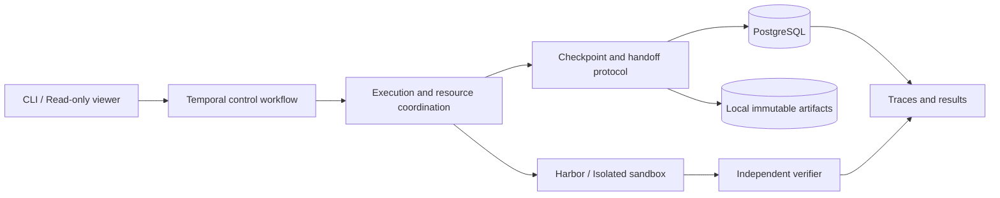

# Relay Trace Verify (RTV)

[](README.md) [](README.en.md)

*A platform for reliable agent execution and evaluation.*

RTV provides checkpoints, cross-agent handoff, fault recovery, and independent evaluation for
long-running coding agents. The platform manages code, context, and execution records so later
executions can continue existing work.

## Capabilities

- **Relay**: preserve consistent workspaces and sessions; continue native Codex sessions or hand workspaces, summaries, and text trajectories to mini-swe-agent.
- **Trace**: link tasks, attempts, executions, tool events, and checkpoints; follow handoffs and model costs.
- **Verify**: run isolated task verifiers and export traceable results; create independent experiment branches from the same checkpoint.
- **Reliable execution**: persist control state with Temporal and PostgreSQL, coordinating local Kubernetes jobs through execution ownership, resource reservations, and cleanup protocols.

Functional acceptance checks correct state transfer, continuation, and recovery within declared
boundaries. Paired experiments describe strategy outcomes; higher relay solve rates are not an
acceptance requirement.

## Status

**F0–M3 have passed local acceptance. M4 has verified real-agent cross-node recovery; formal evaluation remains pending.**

| Capability | Existing validation |
| --- | --- |
| Native recovery and cross-agent handoff | 14 real-model M3 checks pass, covering Codex continuation and three mini-swe-agent handoff policies |
| Checkpoints and execution ownership | Content validation, conditional publication, stale-execution fencing, branch protection, and cost attribution |
| Local Kubernetes | Two control workers and two execution nodes; scripted node-loss and cross-node recovery acceptance |
| Real-agent fault recovery | After executor Job loss, Codex restores its native session and code on another node and passes independent tests; see [recovery evidence](docs/m4-model-recovery.en.md) |
| Real repository execution | Four SWE-bench Verified development tasks; the latest round passes 56 workflow checks and independently grades all 16 branches |
| Traces and presentation | Bilingual read-only experiment viewer, JSON/CSV reports, linked events and artifacts |

See the [acceptance and development records](docs/index.en.md) for test types, scopes, and evidence.
The 20-task formal evaluation remains pending. Local k3d nodes share one physical host.

## Quick start

The core demo requires Python 3.11+ and uv, with no Docker or model credentials:

```bash
uv sync --locked --dev
uv run rtv demo --output work/demo
```

Two deterministic fixtures modify a file, commit a checkpoint, restore into an independent directory,
and run a verifier. Outputs include `events.jsonl`, `report.json`, workspaces, and checkpoints.
Choose a new output directory for each run.

See [demo and deployment](docs/demo.en.md) for real containers and agents.
Optional runtime dependencies require Python 3.12+. Real model execution requires explicit opt-in
and credentials.

Development checks:

```bash
uv run pytest
uv run ruff check src tests scripts
uv run ruff format --check src tests scripts
```

## Architecture and implementation



RTV implements checkpoint publication, execution ownership, recovery and handoff protocols, branch
isolation, and budget attribution. It reuses Harbor task and sandbox integration and Temporal durable
orchestration. Recovery covers declared filesystem workspaces and supported session formats;
external service effects and process memory are outside the checkpoint contract.

## Documentation

| Entry | Contents |
| --- | --- |
| [Demo and deployment](docs/demo.en.md) | From the model-free demo to containers, clusters, and real agents |
| [Documentation and acceptance index](docs/index.en.md) | Implementations, acceptance evidence, and development records |
| [System design](docs/design.en.md) | State model, checkpoints, invariants, and fault handling |
| [Experiment protocol](docs/experiments.en.md) | Functional acceptance, paired observations, costs, and reproducibility |
| [Roadmap](docs/roadmap.en.md) | Completed milestones and remaining work |
| [Learning and references](docs/learning-plan.en.md) | Upstream sources, reproduction scope, and resource planning |

RTV supports learning through reproduction, system implementation, and original exploration.
Its foundations include [Harbor](https://github.com/harbor-framework/harbor),
[Temporal](https://github.com/temporalio/temporal), and
[mini-swe-agent](https://github.com/SWE-agent/mini-swe-agent).
[Ember](https://github.com/RuokeZhang/ember) is a reference for engineering scope.
