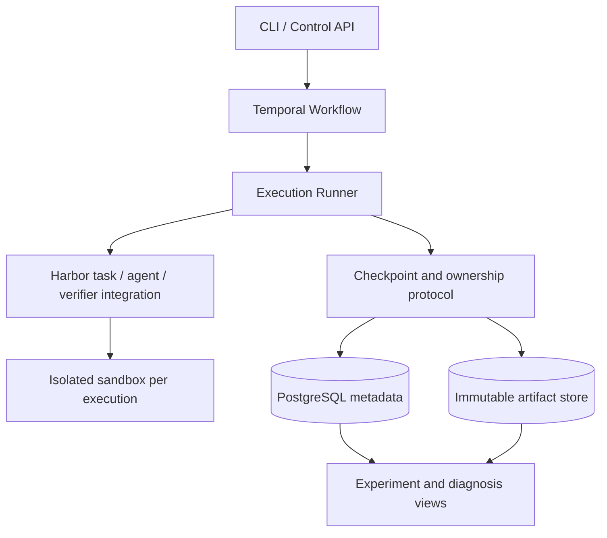

# Relay Trace Verify (RTV)

 

*A platform for reliable agent execution and evaluation.*

A recoverable execution and branching experiment system for long-running coding agents.

**Status: design phase.** This repository currently contains architecture proposals and acceptance plans. The runtime is not implemented yet, and no performance or success-rate improvements have been established.

## Core problem

When an agent gets stuck, a worker disconnects, or a sandbox is destroyed, how can the next execution recover a consistent workspace and session, and fairly compare different continuation strategies from the same checkpoint?

RTV focuses on three capabilities:

1. **Relay**: recover execution, hand work to another agent, or create isolated branches through consistent checkpoints.
2. **Trace**: connect tool events, workspaces, checkpoints, handoffs, and costs to identify the layer where a failure occurred.
3. **Verify**: measure system reliability and agent task performance through independent verification and paired experiments.

## Design documents

| Document | Contents |
| --- | --- |
| [System design](docs/design.en.md) | Object relationships, invariants, checkpoint protocol, failure handling, budgets, and adapter capabilities |
| [Experiment protocol](docs/experiments.en.md) | Paired branches, budget accounting, baselines, statistics, and result artifacts |
| [Roadmap](docs/roadmap.en.md) | Implementation order, acceptance evidence, and open decisions |
| [ADR 0001](docs/adr/0001-runtime-boundary.en.md) | Responsibility boundaries between Harbor, Temporal, and the RTV runtime |

## Proposed architecture

This diagram shows planned responsibilities, not implemented components. A compatibility prototype must establish the specific Harbor integration boundary.

## Technical boundaries

- Harbor: reuse task formats, agent and sandbox adapters, verifiers, and ATIF trajectories.
- Temporal: reuse durable orchestration, timers, and Activity retry mechanisms.
- RTV: implement checkpoint commits, execution ownership, recovery and handoff semantics, branch isolation, and budget attribution.
- Initially support reconstructible local filesystem tasks. External databases, arbitrary process memory, and external service side effects are outside the checkpoint guarantee.
- Collect objective events from the first phase. LLM judges and training-data selection are later extensions.

## First demonstration target

Agent A modifies code → commit a checkpoint → inject a worker failure → recover on another worker → fork from the checkpoint to A and B → verify independently and show complete costs.

Implementation status and experimental conclusions will be recorded separately. Unmeasured numbers will not be presented as project results.

## References

- [Ember](https://github.com/RuokeZhang/ember): a reference for engineering scope.
- [Harbor trajectory loading](https://docs.harborframework.com/jobs/loading-trajectories): loading a session or trajectory does not restore sandbox files.
- [Harbor ATIF](https://docs.harborframework.com/agents/atif): trajectory format and validation.
- [Temporal Activities](https://docs.temporal.io/activity-definition): retry and idempotency boundaries.

Research date: 2026-10-07. Pin dependency versions during implementation and verify capabilities with contract tests.
