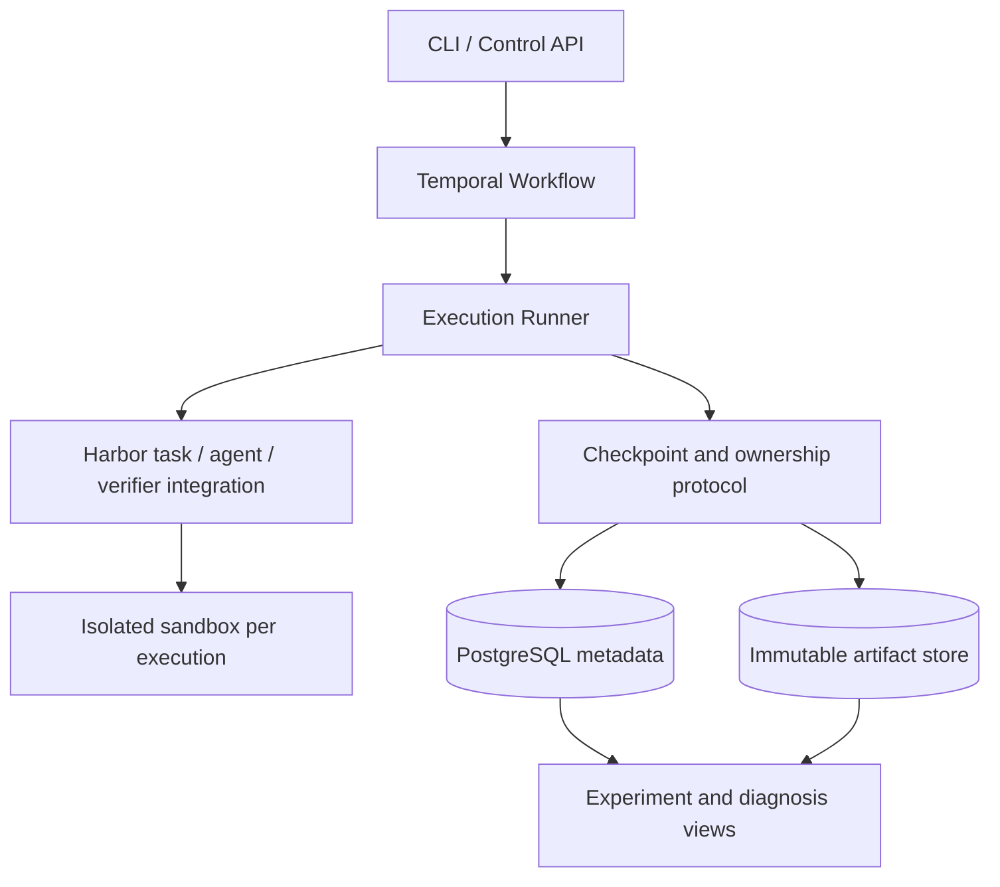

# Relay Trace Verify (RTV)

[](README.md) [](README.en.md)

*A platform for reliable agent execution and evaluation.*

面向长程 Coding Agent 的可恢复执行与分支实验系统。

**状态：F0–M3 已在本机可信开发任务范围内验收。** M3 完成幂等交接、共同检查点的四路分支、独立验证、前缀成本归因和中英文只读页面。48 项零费用协议检查及 14 项真实模型检查通过：原 Codex 会话继续，以及 mini-swe-agent 的工作区、摘要、文本轨迹三种交接均完成任务。当前是功能验收，不代表接力的成功率或成本优势。见 [M3 指南与证据](docs/m3.md)。

RTV 同时用于学习复现、系统实现和自主探索。已有方案会保留为学习材料与对照基线，参考来源和复现范围见[学习与资源计划](docs/learning-plan.md)。目前没有模型效果或分布式可靠性结论。

## 快速开始

需要 Python 3.11+ 和 uv。在仓库根目录执行：

```bash
uv sync --locked --dev
uv run rtv demo --output work/demo
```

演示使用两个确定性 fixture，不调用模型、不需要 API key。A 写入文件并提交检查点，B 从检查点恢复到独立目录、修改结果，最后由 verifier 检查。输出包含 `events.jsonl`、`report.json`、工作区和检查点。

输出目录必须尚不存在；重复运行时换一个目录，例如 `work/demo-2`。本地后端是普通目录，不提供容器或进程隔离。

开发检查：

```bash
uv run pytest
uv run ruff check src tests
uv run ruff format --check src tests
```

模块说明、当前保证和扩展入口见[框架开发指南](docs/framework.md)。

Harbor 原型使用可选依赖组和 Python 3.12+，安装、预检查及容器测试命令见 [M0 指南](docs/m0.md)。普通测试会跳过实际容器测试；单独执行的真实测试及其证据见该指南。

## 核心问题

当 agent 卡住、worker 失联或沙箱销毁时，如何让后续执行获得一致的工作区与会话状态，并从同一个检查点公平比较不同继续策略？

RTV 围绕三个能力展开：

1. **Relay**：通过一致性检查点恢复执行、交给另一个 agent，或创建隔离分支。
2. **Trace**：关联工具事件、工作区、检查点、交接和成本，定位失败发生在哪一层。
3. **Verify**：用独立验证和配对实验衡量系统可靠性与 agent 解题效果。

## 设计入口

| 文档 | 内容 |
| --- | --- |
| [框架开发指南](docs/framework.md) | 当前代码、运行方法、验证范围和集成边界 |
| [M0 接入指南](docs/m0.md) | Harbor 预检查、容器恢复原型、能力矩阵与当前缺口 |
| [Codex 恢复实验](docs/codex-m0.md) | 首个真实 agent、原生会话 / 语义交接、恢复边界与用量证据 |
| [M0 验收与恢复边界](docs/m0-boundaries.md) | ATIF 信息损失、真实取消与回滚、镜像生命周期和能力声明 |
| [M1 持久执行](docs/m1.md) | 本机部署、任务提交 / 取消、故障注入、真实 Codex 与边界 |
| [M2 检查点与恢复](docs/m2.md) | 条件提交、epoch、原生会话恢复、UNKNOWN 用量、引用 GC 与验收 |
| [M3 接力与分支](docs/m3.md) | 第二种 agent、上下文策略、独立验证、只读页面与 API 预算 |
| [学习与资源计划](docs/learning-plan.md) | 开源参考、复现目标、lab GPU 与费用约定 |
| [系统设计](docs/design.md) | 对象关系、不变量、检查点协议、故障处理、预算与能力矩阵 |
| [实验协议](docs/experiments.md) | 配对分支、预算口径、基线、统计及结果产物 |
| [里程碑](docs/roadmap.md) | 实现顺序、验收证据与待决策项 |
| [ADR 0001](docs/adr/0001-runtime-boundary.md) | Harbor / Temporal / 自研 runtime 的职责边界 |
| [ADR 0003](docs/adr/0003-fenced-checkpoints.md) | M2 所有权、检查点提交与回收决策 |

## 预期架构



图中表示完整目标架构。M3 已实现本机交接与实验分支，复用 M2 的 epoch、检查点与账本；mini API 请求单独记账。产物仍存于本地。对象存储、多主机资源 fencing、通用严格预算准入尚未实现。真实双 agent 已在单个固定开发任务上通过功能验收。

## 技术边界

- Harbor：复用任务、agent / sandbox 适配、验证器及 ATIF 轨迹能力。
- Temporal：复用持久化编排、定时器与 Activity 重试机制。
- 本项目：实现检查点提交、执行所有权、恢复 / 交接语义、分支隔离与预算归因。
- 初期限定可重建的本地文件系统任务；外部数据库、任意进程内存和外部服务副作用不包含在检查点保证内。
- 客观事件从第一阶段采集；LLM judge 与训练数据筛选属于后续扩展。

## 首个可演示目标

Agent A 修改代码 → 提交检查点 → 注入 worker 故障 → 在另一 worker 恢复 → 从检查点分别交给 A / B → 独立验证并展示完整成本。

实现与实验结论将分别记录；没有测量的数字不作为项目效果。

## 参考

- [Ember](https://github.com/RuokeZhang/ember)：工程范围参照。
- [Harbor trajectory loading](https://docs.harborframework.com/jobs/loading-trajectories)：会话 / 轨迹加载不等同于沙箱文件恢复。
- [Harbor ATIF](https://docs.harborframework.com/agents/atif)：轨迹格式与验证。
- [Temporal Activities](https://docs.temporal.io/activity-definition)：重试与幂等性边界。

文档调研日期：2026-10-07。实现阶段应固定依赖版本，并用契约测试验证能力。
