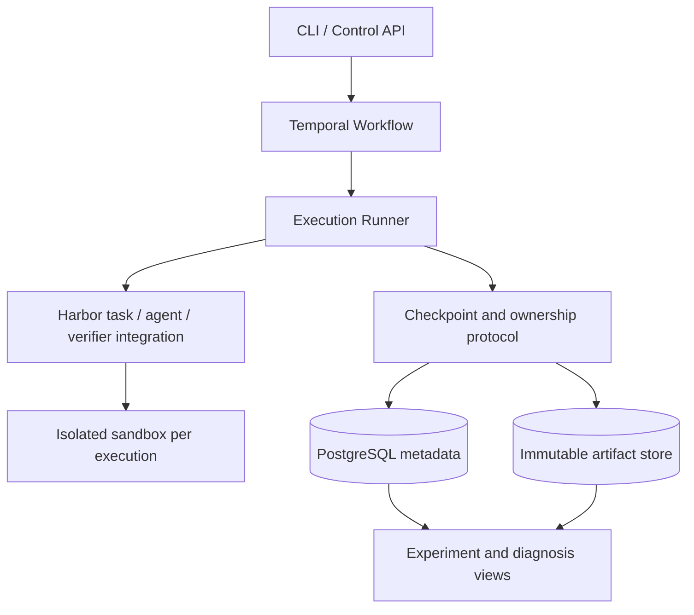

# Relay Trace Verify (RTV)

 

*A platform for reliable agent execution and evaluation.*

面向长程 Coding Agent 的可恢复执行与分支实验系统。

**状态：设计阶段。** 当前仓库包含架构提案与验收计划，尚未实现 runtime，也没有性能或成功率提升结论。

## 核心问题

当 agent 卡住、worker 失联或沙箱销毁时，如何让后续执行获得一致的工作区与会话状态，并从同一个检查点公平比较不同继续策略？

RTV 围绕三个能力展开：

1. **Relay**：通过一致性检查点恢复执行、交给另一个 agent，或创建隔离分支。
2. **Trace**：关联工具事件、工作区、检查点、交接和成本，定位失败发生在哪一层。
3. **Verify**：用独立验证和配对实验衡量系统可靠性与 agent 解题效果。

## 设计入口

| 文档 | 内容 |
| --- | --- |
| [系统设计](docs/design.md) | 对象关系、不变量、检查点协议、故障处理、预算与能力矩阵 |
| [实验协议](docs/experiments.md) | 配对分支、预算口径、基线、统计及结果产物 |
| [里程碑](docs/roadmap.md) | 实现顺序、验收证据与待决策项 |
| [ADR 0001](docs/adr/0001-runtime-boundary.md) | Harbor / Temporal / 自研 runtime 的职责边界 |

## 预期架构

图中表示计划中的职责，不代表组件已经实现。Harbor 的具体接入层级需要先完成兼容性原型。

## 技术边界

- Harbor：复用任务、agent / sandbox 适配、验证器及 ATIF 轨迹能力。
- Temporal：复用持久化编排、定时器与 Activity 重试机制。
- 本项目：实现检查点提交、执行所有权、恢复 / 交接语义、分支隔离与预算归因。
- 初期限定可重建的本地文件系统任务；外部数据库、任意进程内存和外部服务副作用不包含在检查点保证内。
- 客观事件从第一阶段采集；LLM judge 与训练数据筛选属于后续扩展。

## 首个可演示目标

Agent A 修改代码 → 提交检查点 → 注入 worker 故障 → 在另一 worker 恢复 → 从检查点分别交给 A / B → 独立验证并展示完整成本。

实现与实验结论将分别记录；没有测量的数字不作为项目效果。

## 参考

- [Ember](https://github.com/RuokeZhang/ember)：工程范围参照。
- [Harbor trajectory loading](https://docs.harborframework.com/jobs/loading-trajectories)：会话 / 轨迹加载不等同于沙箱文件恢复。
- [Harbor ATIF](https://docs.harborframework.com/agents/atif)：轨迹格式与验证。
- [Temporal Activities](https://docs.temporal.io/activity-definition)：重试与幂等性边界。

文档调研日期：2026-10-07。实现阶段应固定依赖版本，并用契约测试验证能力。
