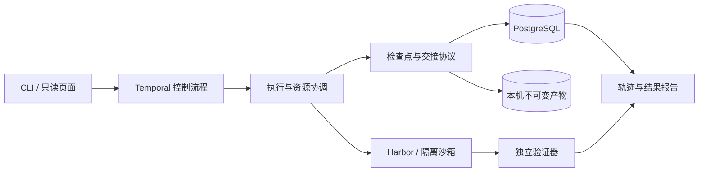

# Relay Trace Verify (RTV)

[](README.md) [](README.en.md)

*A platform for reliable agent execution and evaluation.*

RTV 为长程 Coding Agent 提供检查点、跨 agent 交接、故障恢复和独立评测。
任务的代码、上下文和执行记录由平台管理，让后续执行可以接着已有工作继续。

## 核心能力

- **Relay**：保存一致的工作区与会话；支持 Codex 原生继续，以及向 mini-swe-agent 交接工作区、摘要或文本轨迹。
- **Trace**：关联任务、尝试、执行、工具事件和检查点，追踪交接过程与调用成本。
- **Verify**：隔离运行任务验证器，导出可追溯的结果；从同一检查点创建独立实验分支。
- **Reliable execution**：用 Temporal 与 PostgreSQL 管理持久状态，通过执行所有权、资源预约和清理协议协调本机 Kubernetes 任务。

功能验收检查状态是否正确传递、任务能否继续执行、故障能否按约定恢复。
配对实验用于观察不同执行策略的结果，不要求接力取得更高解题率。

## 当前进展

**F0–M3 已完成本机范围验收；M4 已验证真实 agent 的跨节点恢复，正式评测待完成。**

| 能力 | 已有验证 |
| --- | --- |
| 原生恢复与跨 agent 交接 | M3 的 14 项真实模型检查通过，覆盖 Codex 继续和 mini-swe-agent 三种交接策略 |
| 检查点与执行所有权 | 内容校验、条件提交、旧执行隔离、分支保护及成本归因 |
| 本机 Kubernetes | 两个控制 worker、两个执行节点；脚本任务的节点故障与跨节点恢复通过验收 |
| 真实 agent 故障恢复 | Codex 执行 Job 丢失后在另一节点恢复原生会话与代码，独立测试通过；见[恢复证据](docs/m4-model-recovery.md) |
| 真实仓库执行 | 四个 SWE-bench Verified 开发任务；最近一轮 56 项流程检查通过，16 个分支均完成独立判分 |
| 轨迹与展示 | 中英文只读实验页面，JSON/CSV 报告、事件及产物关联 |

测试类型、适用范围和原始证据入口见[验收与开发记录](docs/index.md)。
20 题正式评测仍待完成；本机 k3d 节点共享一台物理宿主。

## 快速开始

核心演示需要 Python 3.11+ 和 uv，无需 Docker 或模型凭据：

```bash
uv sync --locked --dev
uv run rtv demo --output work/demo
```

两个确定性 fixture 依次修改文件、提交检查点、在独立目录恢复，并运行 verifier。
输出包括 `events.jsonl`、`report.json`、工作区和检查点。重复演示时使用新的输出目录。

使用真实容器与 agent 的运行步骤见[演示与部署](docs/demo.md)。
可选 runtime 依赖需要 Python 3.12+；真实模型运行需显式开启并准备凭据。

开发检查：

```bash
uv run pytest
uv run ruff check src tests scripts
uv run ruff format --check src tests scripts
```

## 架构与实现



RTV 实现检查点提交、执行所有权、恢复与交接协议、分支隔离和预算归因；
复用 Harbor 的任务与沙箱集成，以及 Temporal 的持久编排。
当前恢复范围为声明的文件系统工作区和受支持的会话格式；外部服务副作用与进程内存不在检查点范围内。

## 文档

| 入口 | 内容 |
| --- | --- |
| [演示与部署](docs/demo.md) | 从零费用演示到容器、集群和真实 agent |
| [文档与验收索引](docs/index.md) | 分阶段实现、验收证据和开发记录 |
| [系统设计](docs/design.md) | 状态模型、检查点、不变量与故障处理 |
| [实验协议](docs/experiments.md) | 功能验收、配对观察、成本与复现口径 |
| [路线图](docs/roadmap.md) | 已完成项目与剩余工作 |
| [学习与参考](docs/learning-plan.md) | 上游来源、复现范围和资源计划 |

RTV 同时用于学习复现、系统实现和自主探索。主要基础包括
[Harbor](https://github.com/harbor-framework/harbor)、
[Temporal](https://github.com/temporalio/temporal) 和
[mini-swe-agent](https://github.com/SWE-agent/mini-swe-agent)；
[Ember](https://github.com/RuokeZhang/ember) 是工程范围参考。
