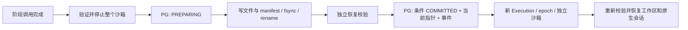

# M2：检查点与可靠恢复

[](m2.md) [](m2.en.md)

2026-10-09：M2 在**单机、可信文件系统任务、本地 Docker**范围通过验收。已完成阶段
可以恢复到新的 Execution 与沙箱；Attempt 保持不变，epoch 递增。旧执行无法发布
当前结果或检查点。真实 Codex 的两阶段原生会话恢复已通过；第二种 agent 与配对分支
实验属于 M3。

## 运行

依赖和本地服务沿用 [M1](m1.md)：Python 3.12+、Harbor 0.24.0、temporalio 1.34.0、
psycopg 3.3.6、PostgreSQL 17.6、Temporal CLI 1.9.1 / Server 1.32.0。
在仓库根目录执行：

```bash
uv sync --python 3.13 --locked --group runtime --dev
uv run --no-sync python scripts/setup_temporal.py
docker compose -f infra/compose.m1.yaml up -d --wait
uv run --no-sync rtv runtime init
uv run --no-sync rtv runtime prepare
```

分别在两个终端启动 Temporal 和 worker；已启动的服务无需重复启动：

```bash
work/tools/temporal server start-dev --ip 127.0.0.1 \
  --db-filename work/runtime-temporal.db --ui-disable-news-fetch
```

```bash
uv run --no-sync rtv runtime worker
```

第三个终端提交两阶段脚本 fixture，**不调用模型**：

```bash
uv run --no-sync rtv runtime submit --key first-m2 --staged --ttl 300 \
  --delay 15 --max-recoveries 1
uv run --no-sync rtv runtime status <trial_id>
uv run --no-sync rtv runtime history <trial_id>
uv run --no-sync rtv runtime events <trial_id>
uv run --no-sync rtv runtime ledger <trial_id>
```

阶段 1 刻意留下空输入缺陷，完成验证、停止沙箱并提交检查点；阶段 2 在新沙箱恢复，
修复缺陷并通过最终验证。阶段推进本身不消耗恢复额度；`--max-recoveries` 默认 0，
允许 0–3 次丢失阶段的重新执行。该选项可能增加真实 agent 的调用次数，必须按费用
约定先说明并确认。它不是 token 或金额上限。

M2 默认目录为 `work/runtime-v2`，数据库 schema 为 `rtv2`，队列为
`rtv-m2-<root-hash>`，Workflow ID 为 `rtv2-<trial_id>`。M1 的目录、`public.rtv_*`
表和旧 Workflow history 保留，**没有自动迁移**；升级前应先结束 M1 的活动任务和
worker。镜像继续复用 `rtv-m1-fixture` / `rtv-m1-codex` 标签，提交时解析为不可变镜像
ID。`RTV_RUNTIME_ROOT` 等配置、同机路径约束和停止服务方法仍见 M1。

## 提交与恢复契约



- **身份与所有权**：每个阶段对应一个物理 Execution、独立目录和 Compose project。
  PostgreSQL 保存当前 execution / epoch，执行者持有 20 秒租约，每 2 秒续约。阶段、
  事件、checkpoint 和结果写入校验身份与租约；控制器终态核对可以越过过期租约，仍须
  匹配当前 epoch。数据库使用自己的时钟判定租约有效性。
- **静止屏障**：阶段调用已返回、验证完成、整个沙箱已停止，确认容器不运行且 PID 为
  0 后导出。范围包括 `/workspace` 普通文件、空目录、文件权限和一个完成的原生会话；
  进程内存、外部服务与任意工具副作用不在其中。
- **manifest v2**：保留 v1 文件哈希和身份，新增任务 / 镜像 / adapter / 模型版本、
  阶段与父 checkpoint、停止证明、事件 ID 边界、账本 revision 和验证结果。恢复前检查
  manifest 哈希、每个文件及工作区 digest；镜像或任务不兼容时拒绝调用 agent。
- **条件提交**：先注册 PREPARING，后写不可变 ID 的本地文件，再提交数据库。只有
  COMMITTED 可恢复；“文件已上传”不等于“已提交”。相同操作 ID 的确认丢失可核对；
  当前执行的提交已完成但结果确认丢失时，控制器从已提交边界收敛。
- **恢复**：失联 supervisor 或租约过期，在已有检查点和恢复额度时自动换 epoch。
  仅 worker 退出时，存活 supervisor 继续运行。容器 / adapter 错误会先失败，可用
  下列手动恢复命令；取消、TTL 耗尽、没有检查点或额度不足均不能恢复。

```bash
uv run --no-sync rtv runtime recover <trial_id> --key recovery-1
```

重复 recovery key 不创建额外执行。若前一个 Temporal 控制 run 已结束，协调器会为
恢复后的任务启动新的控制 run；物理调用仍由独立的 operation ID 防重。恢复不会重置
TTL 或用量。`execution.recovered` 记录源 execution、checkpoint、丢弃阶段和
“最后已提交阶段之后”的损失窗口，不把它误报成精确损失 token 数。

## 用量与引用回收

账本当前以**一次原生 agent 阶段调用或一次 fixture 命令**为粒度。调用前写 PENDING；
收到用量后写 KNOWN，失联 / 被替换时转 UNKNOWN。迟到用量只允许结算原操作，不可
改写当前执行结果；已知用量不能被冲突值覆盖。原生会话恢复只累计本轮增量，前缀计入
一次。Codex 内部各工具调用仍在原始轨迹中，尚未逐工具接管或提供外部副作用去重。
订阅的美元费用为 `null`，UNKNOWN 不算零；没有严格 token / 金额准入。

当前 Trial 的检查点、Execution 的恢复引用、父子链，以及显式引用都受 GC 保护：

```bash
uv run --no-sync rtv runtime pin <checkpoint_id> --owner experiment:example
# 仅在不再需要该终态任务的隐式产物引用时执行；保留状态与历史
uv run --no-sync rtv runtime retire <trial_id>
uv run --no-sync rtv runtime gc --older-than 3600
# 显式引用也不再需要时
uv run --no-sync rtv runtime unpin <checkpoint_id> --owner experiment:example
uv run --no-sync rtv runtime gc --older-than 3600
```

`retire` 要求任务已终态且清理完成，之后不能恢复。GC 先在事务内检查引用并写删除
墓碑，再删文件；pin 与 GC 竞争时只有一方成功。仍存活的上传受保护，废弃 PREPARING
和迟到上传可回收，删除失败可重试。祖先链可能需多轮 sweep。墓碑与原始执行日志保留，
镜像不会被 prune。这里实现的是 M3 所需的引用保护原语，尚未实现真正的实验分叉。

## 验收证据

```bash
uv run --no-sync pytest -q
uv run --no-sync python scripts/m2_acceptance.py --output work/m2-check-new
uv run --no-sync python scripts/m1_acceptance.py --output work/m1-regression-new
# 以下会用现有 ChatGPT 订阅执行两次模型调用；先按项目费用约定确认
uv run --no-sync rtv runtime prepare --adapter codex
uv run --no-sync python scripts/m2_codex_smoke.py --output work/m2-codex-new \
  --auth-file "$HOME/.codex/auth.json" --allow-model-calls
```

输出目录必须尚不存在。测试启动独立 root / queue 的 worker，并在结束时回收自身任务
的容器和网络；服务和镜像保留。

| 证据 | 结果与范围 |
| --- | --- |
| [M2 runtime](evidence/m2-runtime-arm64-20261009.json) | 40 项通过：16 项真实服务 / 容器 fixture 检查，24 项真实数据库 / 文件系统上的合成协议检查 |
| [真实 Codex](evidence/m2-codex-arm64-20261009.json) | 10 项通过：两次订阅调用、同一原生会话、新 Execution、worker 重启、工作区一致、前缀不重复计费、最终 reward=1 |
| [M1 回归](evidence/m2-m1-regression-arm64-20261009.json) | 22 项通过，零模型调用，旧功能在 M2 协议上继续成立 |

真实服务检查包括 SIGSTOP supervisor 等待租约过期，再让旧进程返回；旧阶段 / 结果 /
checkpoint 写入均被拒绝，恢复不带入未提交文件。另一次真实删容器故障验证了失败后
手动恢复和已关闭控制 run 的重启。合成部分明确标注：提交确认窗口、并发恢复、损坏、
UNKNOWN / 迟到结算、pin / GC 竞争及迟到上传，使用构造的数据和用量，不是模型效果数据。

Codex CLI 0.160.1 / `gpt-6-astra`、low reasoning、Linux arm64 镜像：累计观测
85,439 input（其中 68,992 cached input）、691 output tokens；阶段 2 增量是
37,610 input、24,192 cached input、319 output。cached 是 input 的子集。
没有新增付费 API 或云资源；订阅额度消耗不转换为美元账单。原始轨迹与完整 history
只留在忽略的 `work/`。

## 保证范围与下一步

本地存储实现 fsync 与原子 rename，但未做断电测试，不提供磁盘丢失、复制、对象锁或
跨主机恢复保证。epoch fencing 保护 PostgreSQL 权威状态与受控产物发布，不能撤销
已经发给模型或外部服务的请求。独立工作区限制旧执行的文件影响；协调器持续清理旧
Compose 身份，尚未验证宿主机故障、沙箱创建期间硬杀及任意迟到外部副作用。

当前恢复粒度是完整阶段，阶段内文件修改会丢弃。只开放两个仓库内可信任务，没有
任意任务上传、HTTP API 或产品网页。retired execution 的持续扫描偏重正确性；规模化
调度、索引优化和多节点故障留给 M4。此次是协议与兼容性验收，不是大规模 benchmark
或接力成功率结论。

设计与参考见 [ADR 0003](adr/0003-fenced-checkpoints.md)。下一步 M3：接入第二种 agent，
从同一个已提交 checkpoint 创建 A 继续 / B 工作区 / B 摘要三个隔离分支，并展示轨迹
与成本对比。
